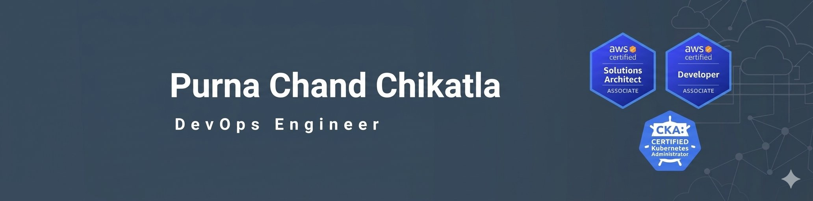

  

# 👋 Hi, I'm Purna Chand Chikatla

### Software Engineer II – Cloud Engineer @ Tata Consultancy Services  
🚀 DevOps • Cloud Engineer | AWS | CI/CD | Kubernetes | Terraform | Docker | Ansible

---

DevOps Engineer at TCS, building automated AWS infrastructure with Terraform, Ansible, Docker, and Kubernetes. CKA and AWS Solutions Architect Associate certified. I started in telecom networking, so I bring a strong networking foundation to cloud and DevOps work.

---

### 🧰 Tech Stack

                  

---

### 🔧 What I Do

- 🛠️ Build and manage infrastructure on **AWS** using **Terraform** for repeatable, secure provisioning  
- ☁️ Design reusable Terraform modules for **VPCs**, **EC2**, **security groups**, and **Auto Scaling**, which cut environment provisioning time by over 60%  
- 🚀 Build security-hardened, size-optimized **Docker images** using multi-stage builds, handle container lifecycle operations, and manage volumes. 
- 📃️ Run containerized workloads on Kubernetes with Deployments, Services, Ingress, and ConfigMaps/Secrets  
- 🤖 Automate infrastructure and operational tasks using **Linux**, **Shell scripting**, and **Python**, improving consistency and speed  
- 🧪 I've deployed workloads to Kubernetes using **Helm charts** and **YAML manifests** for real-time scaling and rollouts. 
- 🔐 Secure cloud environments using **IAM**, **RBAC**, ensuring compliance and access control  
- 📈 Work with development teams to integrate infrastructure provisioning and container builds into **CI/CD pipelines**

---

### 💼 Career Snapshot

- 🏢 **Tata Consultancy Services** – *Cloud & DevOps Enginner*  
  Managing GAIA-based infrastructure with Kubernetes and Jules. Driving CI/CD and observability strategy across critical internal platforms.
  Led cloud automation projects using Terraform, Docker, and CI/CD tools (GitHub Actions, Jenkins) on AWS, resulting in a 40% deployment time reduction.
  Designed secure cloud infrastructure using AWS. Built CI/CD pipelines, implemented IaC, and improved uptime and efficiency.
  
---

## 📊 GitHub Stats

 
 

---

## 🐍 GitHub Contribution Snake

  

---

Thanks for visiting!